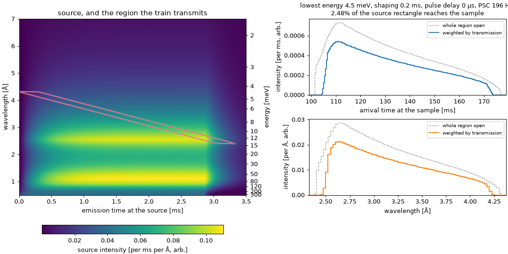

# See BIFROST's source through its train

The ESS source BIFROST sees, from [`tof`](https://tof.readthedocs.io)'s source library,
put through BIFROST's six choppers with the tools on
[Weight the region by a source](weight-by-a-source.md).

On the left is the source over (emission time, wavelength), with the region the train
transmits drawn over it. It's a thin stripe because the pulse-shaping pair is open for a
fraction of a millisecond, and every neutron that gets through crossed it then.

On the right is what reaches the sample, by arrival time and by wavelength, with energy
along the top. The dashed curves count the whole transmitted region as open, the way
`Region.transmit` does. The solid ones weight it by how likely each neutron is to get
through while a disc's edge is still sweeping the beam, as `Region.transmit_weighted` does.

The controls choose:

- **lowest energy:** where chopcal places the band, as `chopcal.bifrost(energy_min=...)`;
- **pulse-shaping time:** the burst the pulse-shaping pair cuts, `shaping_time`;
- **pulse delay:** moves every disc together, as ESS's `BeamPosDly-S` does with the
  experiment delays NICOS sets held fixed. chopcal's settings are for none, so moving it
  slides the stripe along the pulse;
- **pulse-shaping disks:** the 196 Hz disks BIFROST was designed for, or the 126 Hz
  substitutes installed now, as `pulse_shaping_speed_max`. The burst is set by the lag
  between the pair, so the totals hardly move. The slower disks' edges sweep the beam more
  slowly, though, which softens the edges of the profiles by up to 3 % of their peak at the
  shortest bursts.

## How it is made

- **The source:** `tof`'s `ess-bifrost` distribution, summed into 20 µs by 0.025 Å bins
  over 0–3.5 ms and 0.5–7 Å. That rectangle is also the source polygon chopcal transmits.
  `tof` counts emission times 5 cm from the moderator, so every chopper path and the
  sample distance are shortened by 5 cm to match.
- **The discs:** each has two apertures. `beam_aperture(..., at='inner')`, the default
  `chopcal.bifrost` uses, bounds the outline. `beam_aperture(..., at='centre')` sets the
  ramps of the weighted transmission. The pulse-shaping pair and the bandwidth pair are
  each a group: `groups=[0, 0, 1, 2, 3, 3]`.
- **The interactive figure:** `scripts/bifrost_intensity_figure.py` pre-computes every
  combination of the controls, and this page draws the one selected. The source picture
  stays the same throughout. A notebook version with a free choice of every setting, the
  source rectangle and its binning lives in the ESS code shelf.
